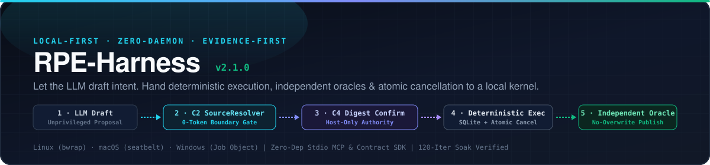

<div align="center">



<br />

[](https://github.com/Audrey-cn/rpe-harness/actions/workflows/ci.yml)

`v2.1.0` · `Linux (bwrap) / macOS (seatbelt) / Windows (Job Object)` · `Zero-Dep Stdio MCP` · `Contract Plugin SDK` · `120-Iter Soak` · `MIT License`

<p><strong>English</strong> | <a href="README.zh-CN.md"><strong>简体中文</strong></a></p>

<p>
  <a href="#-what-rpe-harness-does-for-your-coding-agents">Why RPE</a> ·
  <a href="#-architecture">Architecture</a> ·
  <a href="#-how-rpe-compares">vs Alternatives</a> ·
  <a href="#-5-family-live-benchmarks">5-Family Benchmarks</a> ·
  <a href="#-30-second-quickstart">Quickstart</a> ·
  <a href="#-honest-scope--current-limits">Honest Limits</a>
</p>

</div>

---

## 🎯 What RPE-Harness Does for Your Coding Agents

If you use **Claude Code, Codex CLI, Hermes, or custom AI agents** on real local files, you've probably hit the same three frustrations: **burning tokens on repeated retries, babysitting outputs to catch subtle mistakes, and worrying an agent will overwrite the wrong file.**

**RPE-Harness** sits right underneath your coding agent as a lightweight local kernel (1 SQLite file, 1 pip dependency, zero cloud setup) to improve three everyday dimensions:

- **💰 Cut Token Budget (59%–82% fewer tokens in live tests)** — Stop paying an LLM to ingest giant files or burn 20k+ tokens discovering that a requirement is missing or two docs contradict each other. RPE's **C2 SourceResolver** catches missing/conflicting inputs in `~1 ms` at **0 tokens**, and for valid tasks the LLM only writes a tiny structured draft while deterministic local code processes the data (`O(1)` token cost regardless of file size).
- **⚡ Boost Reliability & Speed (Zero babysitting)** — No more manually diffing whether an AI silently dropped leading zeros (`0041` → `41`), altered JSON numbers (`1.0` → `1`, `-0` → `0`), or clobbered your original file. Every output is automatically verified by an **Independent Artifact Oracle** before atomic no-overwrite publish—and if you hit **Cancel** mid-run, RPE cleanly fences publication or tells you honestly if it already landed.
- **🎯 Lock Down Precision & Control** — Keep the LLM doing what it's best at (understanding messy natural-language intent), while locking actual execution behind **digest-bound user confirmation** (`C4 HostAPI`). A model can never forge approval, silently mutate parameters after you click confirm, or replay a stale draft across hosts.

> **When to plug it in:** Anytime you want an AI coding agent to handle repeatable local data/file workflows, enforce a hard human-approval gate before touching disk, or run the same safe task protocol across Claude Code, Codex CLI, Hermes, and Node.js tools.

---

## 🏗️ Architecture

```mermaid
flowchart LR
    U["Natural Language Task + Authorized Sources"] --> C2["C2 SourceResolver\n(0-Token Gate: found / needs_user / conflict / stale / forbidden)"]
    C2 -->|Authorized Facts Only| LLM["Any LLM / Host\n(MiMo · DeepSeek · GPT · Gemini)"]
    LLM -->|Unprivileged Draft| C4S["C4 HostAPI.start_task\n(operation_id + generation=1)"]
    C4S --> C4C["C4 HostAPI.confirm_task\n(Host-Only TrustedHostAction + Digest Lock)"]
    C4C --> EXEC["Deterministic Executor\n(Atomic Cancel Fence · No Overwrite)"]
    EXEC --> ORACLE["Independent Artifact Oracle\n(Hash + Lexical + Row Invariants)"]
    ORACLE -->|Verified| PUB["Atomic Publish + SQLite Audit Receipt"]
```



### Core Capabilities (`v2.1.0`)

| Layer | Module | Guarantee |
| :--- | :--- | :--- |
| **Zero-Dep Stdio MCP Server** | [`mcp_server.py`](src/rpe_harness/mcp_server.py) | `rpe-harness mcp` speaks pure stdlib JSON-RPC 2.0 MCP for **Claude Code, Codex CLI, Cursor, and Hermes**. Exposes **only** model-safe tools (`rpe_capabilities`, `rpe_start_task`, `rpe_show_task`, `rpe_reconcile_task`); keeps `confirm/execute/cancel/handoff` strictly host-side and prevents owner/session spoofing. |
| **Contract Plugin SDK (`rpe.contract/v1`)** | [`contract_sdk.py`](src/rpe_harness/contract_sdk.py) | Declarative `ContractPlugin` interface (`validate_options`, `execute`, `verify`) with Python `entry_points` (`rpe_harness.contracts`) discovery. Ships **5 built-in verified contracts** (`tabular.deduplicate`, `tabular.filter`, `json.normalize`, `json.patch`, `xlsx.inspect`), all backed by independent oracles and atomic no-overwrite publish. |
| **C2 · Narrow Source Resolver** | [`source_resolver.py`](src/rpe_harness/source_resolver.py) | Resolves individual authorized fields in ≤2 bounded reads; blocks `needs_user`, `conflict`, `stale` (SHA mismatch), and `forbidden` (cross-job/session) in **~1 ms at 0 tokens** without leaking private fields into prompts. |
| **C4 · Host-Neutral Task Facade** | [`host_api.py`](src/rpe_harness/host_api.py) · [`operations.py`](src/rpe_harness/operations.py) · [`host_cli.py`](src/rpe_harness/host_cli.py) | 7 host-neutral methods (`start`, `show`, `confirm`, `execute`, `cancel`, `reconcile`, `handoff`) + thin JSON CLI (`rpe host ...`). Imports **no** agent loop; reuses existing SQLite ledgers. |
| **C4 · Atomic Cancel-vs-Publish** | [`storage.py`](src/rpe_harness/storage.py) · [`server.py`](src/rpe_harness/server.py) · [`file_lock.py`](src/rpe_harness/file_lock.py) | Idempotent CLI (`runs cancel`) & guarded loopback HTTP (`POST /runs/<id>/cancel`). Immediately fences publication; returns honest `too_late` if publication already started; portable `fcntl` (POSIX) + `msvcrt` (Windows) locking. |
| **Universal Host Adapters** | [`integrations/dsh/`](integrations/dsh/) · [`integrations/hermes/`](integrations/hermes/) | Zero-dependency Node.js ESM &amp; Python thin bridges (`execFile` over `rpe host`) ready for **Claude Code, Codex CLI, Hermes, or any custom agent host**. Injects non-spoofable `host_id` / `owner` / `session_id`; invalidates prior confirmations on cross-host handoff. |
| **3-OS Containment & Signed Assets** | [`evolution/sandbox.py`](src/rpe_harness/evolution/sandbox.py) · [`assets/`](src/rpe_harness/assets/) | Native OS containment across all 3 platforms: macOS `sandbox-exec`, Linux `bwrap` (`bubblewrap`), and Windows Win32 **Job Object** (`ctypes`: hard process memory cap + `ActiveProcessLimit=1` + `KILL_ON_JOB_CLOSE`), paired with honest `sandbox_capabilities()` reporting and SHA-256 / RSA-SHA256 asset provenance. |

---

## ⚖️ How RPE Compares

| Dimension | **LangGraph** | **Temporal / Trigger.dev** | **PydanticAI / TrueForge** | **RPE-Harness** |
| :--- | :--- | :--- | :--- | :--- |
| **Primary Role** | Multi-agent state graph orchestration | Cloud-native durable workflow cluster | Typed agent SDK / cloud runtime | **Local-first verifiable execution & approval kernel** |
| **Infrastructure** | Heavy framework + checkpointer | Temporal server / cloud workers | SDK + external sandbox/telemetry | **Zero daemon · 1 SQLite file · 1 pip dep (`openpyxl`)** |
| **HITL Boundary** | Graph `interrupt()` node | Workflow waitpoint | Tool-call approval | **Host-only `TrustedHostAction` + `proposal digest` + cross-host invalidation** |
| **Result Proof** | User-written node logic | Workflow code | Schema + LLM-as-a-judge | **Independent deterministic Oracle + atomic no-overwrite publish** |
| **Cross-Platform** | Python / JS | Cloud / Docker | Python / TS | **Linux · macOS · Windows (Python + Node.js Universal Adapters)** |

---

## 📊 5-Family Live Benchmarks

Measured on **2026-11-27** across **5 model families (20/20 Oracle pass)** on identical controlled tasks (2 positive deterministic execution tasks + 2 negative boundary probes — full receipts in [`reports/v1.18.0/c3-multimodel-comparison/`](reports/v1.18.0/c3-multimodel-comparison/README.md)):

| Model | Harness Mode | RPE Pass | Native Pass | RPE Total Cost | Native Total Cost | Reduction |
| :--- | :--- | :---: | :---: | ---: | ---: | ---: |
| **`mimo-v2.6-pro`** (Xiaomi) | Raw Chat API | **4/4** | 4/4 | **309 tok** | 869 tok | **−64.4%** |
| **`deepseek-chat`** (DeepSeek) | Raw Chat API | **4/4** | 4/4 | **219 tok** | 541 tok | **−59.5%** |
| **`qwen4-max`** (Alibaba Qwen) | Raw Chat API | **4/4** | 4/4 | **362 tok** | 885 tok | **−59.1%** |
| **`gpt-6.1-sol`** (OpenAI) | `codex-cli` Agent CLI | **4/4** | 4/4 | **28,156 tok** | 88,086 tok | **−68.0%** |
| **`Gemini`** (Google) | Antigravity Subagent | **4/4** | 4/4 | **159 chars** *(2 calls)* | 203 chars *(4 calls)* | **−21.7% chars** *(tokens unexposed)* |

> **Evidence-First Caveats:** These are 4 controlled small-file tasks per model (6-row CSV / 7-row JSON), not a multi-hour unattended benchmark. `codex-cli` counts include full CLI system/tool prompt overhead (comparable only within the same harness); Gemini's subagent harness does not expose raw provider tokens so output characters and call counts are reported honestly instead. In a separate real-Hermes XLSX comparison (`v1.15.3`, [`report`](reports/v1.15.3/1.15.3兼容与复验.md)), RPE produced byte-identical output with **−82.8%** fewer tokens (`11,755` vs `68,327`).

---

## 🚀 30-Second Quickstart

### 1. Install (Linux / macOS / Windows)

```bash
git clone https://github.com/Audrey-cn/rpe-harness.git
cd rpe-harness
python -m venv .venv
# macOS/Linux: source .venv/bin/activate  |  Windows: .venv\Scripts\activate
pip install -e ".[dev]"
rpe-harness host capabilities
```

### 2. Mount in Claude Code / Codex CLI / Cursor via 5-Line `mcp.json`

```json
{
  "mcpServers": {
    "rpe-harness": {
      "command": "rpe-harness",
      "args": ["mcp", "--owner", "alice", "--session-id", "dev-1", "--workspace", "/path/to/workspace"]
    }
  }
}
```

> Only model-safe read/proposal tools (`rpe_capabilities`, `rpe_start_task`, `rpe_show_task`, `rpe_reconcile_task`) are exposed over MCP. Approval & execution stay strictly host-side (`rpe-harness host confirm` / `execute`).

### 3. Register Your Own Verifiable Contract (`ContractPlugin` SDK)

```python
from rpe_harness.contract_sdk import ContractPlugin, DEFAULT_REGISTRY

DEFAULT_REGISTRY.register(ContractPlugin(
    capability="acme.redact",
    executor_id="plugin/acme-redact",
    input_formats=("txt",),
    validate_options=lambda opts, raw: {},
    execute=lambda plan, raw: (raw.replace(b"SECRET", b"[REDACTED]"), {}),
    verify=lambda plan, raw, staged: {
        "passed": b"SECRET" not in staged,
        "checks": {"secret_removed": b"SECRET" not in staged},
    },
))
```

Or publish via `[project.entry-points."rpe_harness.contracts"]` in `pyproject.toml` for automatic discovery.

### 4. Embed from Python (`HostAPI`) or Node.js

```python
from rpe_harness.host_api import HostAPI, TrustedHostAction

api = HostAPI("/path/to/runs.sqlite")

# 1. Model drafts an unprivileged operation (never auto-confirms)
op = api.start_task(request_payload, {
    "host_id": "my-app", "owner": "alice",
    "session_id": "sess-1", "workspace": "/path/to/workspace",
})

# 2. Only your trusted host UI callback constructs TrustedHostAction
receipt = api.confirm_task(
    op["operation_id"], op["digest"],
    TrustedHostAction(owner="alice", operation_id=op["operation_id"],
                      generation=op["generation"], digest=op["digest"], actor="alice"),
)

# 3. Deterministic execution + independent oracle verification
result = api.execute_task(op["operation_id"], "alice", confirmation_id=receipt["confirmation_id"])
```

### 3. Embed from Node.js / Any JS Host (Claude Code · Codex CLI · Custom Agents)

```js
import { createDshRpePlugin } from './integrations/dsh/index.mjs'; // zero-dep Node.js reference bridge

const { modelTools, trustedActions } = createDshRpePlugin({
  dbPath: '/path/to/runs.sqlite',
  repoRoot: '/path/to/rpe-harness',
});

// Expose ONLY `modelTools` to the LLM; keep `trustedActions` strictly host-side
const op = await modelTools.rpe_start_task(modelDraft, {
  owner: 'alice', sessionId: 'host-sess-1', workspace: '/path/to/workspace',
});
const conf = await trustedActions.confirmTask({
  operationId: op.operation_id, digest: op.digest,
  generation: op.generation, owner: 'alice', userApproved: true,
});
const res = await trustedActions.executeTask({
  operationId: op.operation_id, owner: 'alice', confirmationId: conf.confirmation_id,
});
```

---

## ⚠️ Honest Scope & Current Limits

We publish boundaries as openly as benchmarks:

1. **Built-in contracts vs custom plugins**: The kernel ships **5 verified built-in contracts** (`tabular.deduplicate`, `tabular.filter`, `json.normalize`, `json.patch`, `xlsx.inspect`) plus the **`rpe.contract/v1` Plugin SDK** (`entry_points`) so teams can plug in domain-specific deterministic executors + independent oracles without touching kernel internals.
2. **OS containment scope across platforms**: `sandbox_capabilities()` reports exact guarantees per OS — macOS `sandbox-exec` and Linux `bwrap` enforce process + filesystem + network isolation; Windows `windows-job-object` enforces hard process memory, `ActiveProcessLimit=1`, and process-tree `KILL_ON_JOB_CLOSE` containment (filesystem/network remain host ACL, honestly declared rather than faked).
3. **Soak vs multi-day chaos**: `v2.1.0` ships a reproducible **120-iteration fault-injection soak harness** ([`scripts/soak_test.py`](scripts/soak_test.py), [`receipt`](reports/v2.1.0/soak/README.md): **120/120 pass**, 0 leaked staging files, SQLite `PRAGMA integrity_check == ok`); multi-day distributed chaos benchmarks remain out of scope for a single-node local kernel.

---

## 📚 Documentation & Verification

| Topic | Link |
| :--- | :--- |
| Full Chinese documentation & CLI/HTTP reference | [README.zh-CN.md](README.zh-CN.md) |
| Progenitor / Akasha asset fusion design | [docs/fusion.md](docs/fusion.md) |
| Node.js universal host bridge reference & E2E tests | [integrations/dsh/README.md](integrations/dsh/README.md) |
| 4-family live C3 comparison report | [reports/v1.18.0/c3-multimodel-comparison/README.md](reports/v1.18.0/c3-multimodel-comparison/README.md) |
| Real-Hermes XLSX paired verification (`v1.15.3`) | [reports/v1.15.3/1.15.3兼容与复验.md](reports/v1.15.3/1.15.3兼容与复验.md) |
| License | [MIT](LICENSE) · [Third-Party Notices](THIRD_PARTY_NOTICES.md) |
