<div align="center">


<br />

[](https://github.com/Audrey-cn/rpe-harness/actions/workflows/ci.yml)

`v1.19.0` · `Linux / macOS / Windows` · `Python 3.10+ & Node.js 20+` · `Zero Daemon` · `SQLite + 1 Dep` · `MIT License`

<p><strong>English</strong> | <a href="README.zh-CN.md"><strong>简体中文</strong></a></p>

<p>
  <a href="#-why-rpe-harness">Why RPE</a> ·
  <a href="#-architecture">Architecture</a> ·
  <a href="#-how-rpe-compares">vs Alternatives</a> ·
  <a href="#-4-family-live-benchmarks">4-Family Benchmarks</a> ·
  <a href="#-30-second-quickstart">Quickstart</a> ·
  <a href="#-honest-scope--current-limits">Honest Limits</a>
</p>

</div>

---

## 🎯 Why RPE-Harness

Most AI agent frameworks focus on giving LLMs **more autonomy** to call tools and grade their own output. In real local workflows, that causes four recurring failure modes:

1. **Self-grading illusions** — An agent claims a file was transformed correctly while silently dropping leading zeros (`0041` → `41`), rewriting lexical JSON (`1.0` → `1`, `-0` → `0`), or clobbering the original file.
2. **Forged or stale approvals** — Ordinary tool approval lets models mutate parameters, or a delayed UI click confirms a draft whose input file has already changed.
3. **Cancel-vs-publish lies** — Clicking "Stop" while a worker is writing either corrupts output or falsely claims rollback after publication already occurred.
4. **Wasted tokens on unresolvable prompts** — Heavy agent loops burn tens of thousands of tokens before realizing a required business constraint is missing or two source docs contradict each other.

**RPE-Harness flips the authority model:**

> **Let the LLM draft intent. Keep authorized source resolution, digest-bound user confirmation, deterministic execution, independent oracle verification, and atomic cancellation inside a zero-daemon local SQLite kernel.**

---

## 🏗️ Architecture

```mermaid
flowchart LR
    U["Natural Language Task + Authorized Sources"] --> C2["C2 SourceResolver\n(0-Token Gate: found / needs_user / conflict / stale / forbidden)"]
    C2 -->|Authorized Facts Only| LLM["Any LLM / Host\n(MiMo · DeepSeek · GPT · Gemini)"]
    LLM -->|Unprivileged Draft| C4S["C4 HostAPI.start_task\n(operation_id + generation=1)"]
    C4S --> C4C["C4 HostAPI.confirm_task\n(Host-Only TrustedHostAction + Digest Lock)"]
    C4C --> EXEC["Deterministic Executor\n(Atomic Cancel Fence · No Overwrite)"]
    EXEC --> ORACLE["Independent Artifact Oracle\n(Hash + Lexical + Row Invariants)"]
    ORACLE -->|Verified| PUB["Atomic Publish + SQLite Audit Receipt"]
```



### Core Capabilities (`v1.19.0`)

| Layer | Module | Guarantee |
| :--- | :--- | :--- |
| **C2 · Narrow Source Resolver** | [`source_resolver.py`](src/rpe_harness/source_resolver.py) | Resolves individual authorized fields in ≤2 bounded reads; blocks `needs_user`, `conflict`, `stale` (SHA mismatch), and `forbidden` (cross-job/session) in **~1 ms at 0 tokens** without leaking private fields into prompts. |
| **C4 · Host-Neutral Task Facade** | [`host_api.py`](src/rpe_harness/host_api.py) · [`operations.py`](src/rpe_harness/operations.py) · [`host_cli.py`](src/rpe_harness/host_cli.py) | 7 host-neutral methods (`start`, `show`, `confirm`, `execute`, `cancel`, `reconcile`, `handoff`) + thin JSON CLI (`rpe host ...`). Imports **no** agent loop; reuses existing SQLite ledgers. |
| **C4 · Atomic Cancel-vs-Publish** | [`storage.py`](src/rpe_harness/storage.py) · [`server.py`](src/rpe_harness/server.py) · [`file_lock.py`](src/rpe_harness/file_lock.py) | Idempotent CLI (`runs cancel`) & guarded loopback HTTP (`POST /runs/<id>/cancel`). Immediately fences publication; returns honest `too_late` if publication already started; portable `fcntl` (POSIX) + `msvcrt` (Windows) locking. |
| **A2 · Second-Host DSH Adapter** | [`integrations/dsh/`](integrations/dsh/) | Zero-dependency Node.js ESM plugin (`execFile` over `rpe host`). Injects non-spoofable `host_id: "dsh"` / `owner` / `session_id`; keeps `confirm/execute/cancel/handoff` strictly host-only; invalidates prior confirmations on cross-host handoff (**G2 Gate**). |
| **Signed Capability Assets** | [`assets/`](src/rpe_harness/assets/) · [`evolution/`](src/rpe_harness/evolution/) | Absorbs Progenitor's content-addressed SHA-256 packages & RSA-SHA256 dual-signed provenance without P2P/IPFS daemons. Imported assets default to `unverified` and require independent acceptance before CAS activation or rollback. |
| **OS Sandbox Backends** | [`evolution/sandbox.py`](src/rpe_harness/evolution/sandbox.py) | Supports macOS `/usr/bin/sandbox-exec` and Linux `bwrap` (bubblewrap) with RSS/timeout monitoring; fails closed (`unavailable`) on unsupported hosts — never fakes isolation. |

---

## ⚖️ How RPE Compares

| Dimension | **LangGraph** | **Temporal / Trigger.dev** | **PydanticAI / TrueForge** | **RPE-Harness** |
| :--- | :--- | :--- | :--- | :--- |
| **Primary Role** | Multi-agent state graph orchestration | Cloud-native durable workflow cluster | Typed agent SDK / cloud runtime | **Local-first verifiable execution & approval kernel** |
| **Infrastructure** | Heavy framework + checkpointer | Temporal server / cloud workers | SDK + external sandbox/telemetry | **Zero daemon · 1 SQLite file · 1 pip dep (`openpyxl`)** |
| **HITL Boundary** | Graph `interrupt()` node | Workflow waitpoint | Tool-call approval | **Host-only `TrustedHostAction` + `proposal digest` + cross-host invalidation** |
| **Result Proof** | User-written node logic | Workflow code | Schema + LLM-as-a-judge | **Independent deterministic Oracle + atomic no-overwrite publish** |
| **Cross-Platform** | Python / JS | Cloud / Docker | Python / TS | **Linux · macOS · Windows (Python + Node.js DSH)** |

---

## 📊 4-Family Live Benchmarks

Measured on **2026-11-27** across **4 model families** on identical controlled tasks (2 positive deterministic execution tasks + 2 negative boundary probes — full receipts in [`reports/v1.18.0/c3-multimodel-comparison/`](reports/v1.18.0/c3-multimodel-comparison/README.md)):

| Model | Harness Mode | RPE `v1.18` Pass | Native Pass | RPE Total Cost | Native Total Cost | Reduction |
| :--- | :--- | :---: | :---: | ---: | ---: | ---: |
| **`mimo-v2.6-pro`** (Xiaomi) | Raw Chat API | **4/4** | 4/4 | **309 tok** | 869 tok | **−64.4%** |
| **`deepseek-chat`** (DeepSeek) | Raw Chat API | **4/4** | 4/4 | **219 tok** | 541 tok | **−59.5%** |
| **`gpt-6.1-sol`** (OpenAI) | `codex-cli` Agent CLI | **4/4** | 4/4 | **28,156 tok** | 88,086 tok | **−68.0%** |
| **`Gemini`** (Google) | Antigravity Subagent | **4/4** | 4/4 | **159 chars** *(2 calls)* | 203 chars *(4 calls)* | **−21.7% chars** *(tokens unexposed)* |

> **Evidence-First Caveats:** These are 4 controlled small-file tasks per model (6-row CSV / 7-row JSON), not a multi-hour unattended benchmark. `codex-cli` counts include full CLI system/tool prompt overhead (comparable only within the same harness); Gemini's subagent harness does not expose raw provider tokens so output characters and call counts are reported honestly instead. In a separate real-Hermes XLSX comparison (`v1.15.3`, [`report`](reports/v1.15.3/1.15.3兼容与复验.md)), RPE produced byte-identical output with **−82.8%** fewer tokens (`11,755` vs `68,327`).

---

## 🚀 30-Second Quickstart

### 1. Install (Linux / macOS / Windows)

```bash
git clone https://github.com/Audrey-cn/rpe-harness.git
cd rpe-harness
python -m venv .venv
# macOS/Linux: source .venv/bin/activate  |  Windows: .venv\Scripts\activate
pip install -e ".[dev]"
rpe-harness host capabilities
```

### 2. Embed from Python (`HostAPI`)

```python
from rpe_harness.host_api import HostAPI, TrustedHostAction

api = HostAPI("/path/to/runs.sqlite")

# 1. Model drafts an unprivileged operation (never auto-confirms)
op = api.start_task(request_payload, {
    "host_id": "my-app", "owner": "alice",
    "session_id": "sess-1", "workspace": "/path/to/workspace",
})

# 2. Only your trusted host UI callback constructs TrustedHostAction
receipt = api.confirm_task(
    op["operation_id"], op["digest"],
    TrustedHostAction(owner="alice", operation_id=op["operation_id"],
                      generation=op["generation"], digest=op["digest"], actor="alice"),
)

# 3. Deterministic execution + independent oracle verification
result = api.execute_task(op["operation_id"], "alice", confirmation_id=receipt["confirmation_id"])
```

### 3. Embed from Node.js / DSH (`integrations/dsh/`)

```js
import { createDshRpePlugin } from './integrations/dsh/index.mjs';

const { modelTools, trustedActions } = createDshRpePlugin({
  dbPath: '/path/to/runs.sqlite',
  repoRoot: '/path/to/rpe-harness',
});

// Expose ONLY `modelTools` to the LLM; keep `trustedActions` strictly host-side
const op = await modelTools.rpe_start_task(modelDraft, {
  owner: 'alice', sessionId: 'dsh-1', workspace: '/path/to/workspace',
});
const conf = await trustedActions.confirmTask({
  operationId: op.operation_id, digest: op.digest,
  generation: op.generation, owner: 'alice', userApproved: true,
});
const res = await trustedActions.executeTask({
  operationId: op.operation_id, owner: 'alice', confirmationId: conf.confirmation_id,
});
```

---

## ⚠️ Honest Scope & Current Limits

We publish boundaries as openly as benchmarks:

1. **Narrow built-in contract surface**: Today the kernel ships **3 verified built-in capabilities** (`tabular.deduplicate` for CSV/XLSX, `json.normalize/v1`, and audited XLSX inspection). It is a reference verifiable execution kernel, not a 100-tool general automation suite.
2. **OS sandbox availability**: Strong process/filesystem/network isolation for untrusted candidate code uses macOS `/usr/bin/sandbox-exec` or Linux `bwrap` (`bubblewrap`); on Windows or hosts without `bwrap`, `sandbox_backend()` honestly reports `unavailable` and fails closed.
3. **Production UI & multi-hour soak**: Desktop UI integration (NewCC) and multi-hour unattended soak benchmarks (`G3`/`G4`) are still active downstream work — current proof covers unit/integration invariants, 3-OS CI, and controlled multi-model pairs.

---

## 📚 Documentation & Verification

| Topic | Link |
| :--- | :--- |
| Full Chinese documentation & CLI/HTTP reference | [README.zh-CN.md](README.zh-CN.md) |
| Progenitor / Akasha asset fusion design | [docs/fusion.md](docs/fusion.md) |
| DSH second-host adapter guide & E2E tests | [integrations/dsh/README.md](integrations/dsh/README.md) |
| 4-family live C3 comparison report | [reports/v1.18.0/c3-multimodel-comparison/README.md](reports/v1.18.0/c3-multimodel-comparison/README.md) |
| Real-Hermes XLSX paired verification (`v1.15.3`) | [reports/v1.15.3/1.15.3兼容与复验.md](reports/v1.15.3/1.15.3兼容与复验.md) |
| License | [MIT](LICENSE) · [Third-Party Notices](THIRD_PARTY_NOTICES.md) |
