<div align="center">


<br />

[](https://github.com/Audrey-cn/rpe-harness/actions/workflows/ci.yml)

`v2.0.0` · `Linux / macOS / Windows` · `零依赖 Stdio MCP` · `可插拔合约 SDK` · `SQLite + 1 个依赖` · `MIT 许可证`

<p><a href="README.md"><strong>English</strong></a> | <strong>简体中文</strong></p>

<p>
  <a href="#-rpe-harness-能为你的编程-agent-带来什么">为什么用 RPE</a> ·
  <a href="#-核心架构">核心架构</a> ·
  <a href="#-竞品对比">竞品对比</a> ·
  <a href="#-五大家族真实对照实测">五大家族实测</a> ·
  <a href="#-30-秒快速上手">快速上手</a> ·
  <a href="#-诚实的当前边界">当前边界</a>
</p>

</div>

---

## 🎯 RPE-Harness 能为你的编程 Agent 带来什么？

如果你平时用 **Claude Code、Codex CLI、Hermes 或自研 Agent** 处理本地文件与工程任务，一定遇到过这三个最头疼的问题：**Token 烧得快、跑完还得人工肉眼复核怕出错、点“允许”又怕它把源文件改坏。**

**RPE-Harness** 就像装在 Agent 底层的轻量级“本地执行安全阀”（零后台服务、单 SQLite 账本、仅 1 个依赖），直接从开发者最关心的三个维度提效：

- **💰 省预算（实测节省 59%–82% Token）**——别再让大模型整篇吞大文件，或者烧掉几万 Token 才发现少了个关键条件、两份文档写冲突了。RPE 的 **C2 `SourceResolver`** 会在调用模型前 `~1 ms`、**0 Token** 精准拦截缺参/冲突；正常任务也只让模型输出几十个字的轻量草案，真正的文件处理交给本地确定性代码（文件再大，Token 消耗也是常数级）。
- **⚡ 提效率（告别反复返工与人工盯梢）**——不用再每次肉眼检查 AI 有没有悄悄吃掉前导零（`0041` → `41`）、改坏 JSON 数值（`1.0` → `1` / `-0` → `0`）或覆盖原文件。每次产物都会经过**独立 Oracle 自动验真**再独占原子落盘；中途想停，**原子取消**也会干净收敛、绝不留下半截脏文件。
- **🎯 保精度与可控性（把“理解”和“执行”分开）**——让大模型专心做它最擅长的事（理解模糊的自然语言并整理清单），真正落盘前必须走宿主侧的 **digest 绑定确认（C4 `HostAPI`）**，杜绝模型擅自改参数、拿旧草稿误执行或跨宿主重放旧授权。

> **最适合什么场景？** 当你需要让编程 Agent 稳定处理可复用的本地数据/文件工作流、在写盘前加一道不可绕过的人工确认闸门，或者想在 Claude Code、Codex CLI、Hermes 与 Node.js 工具之间复用同一套安全执行协议时，直接挂上 RPE-Harness 即可。

---

## 🏗️ 核心架构

```mermaid
flowchart LR
    U["自然语言任务 + 授权来源"] --> C2["C2 SourceResolver\n(0-Token 门禁：found / needs_user / conflict / stale / forbidden)"]
    C2 -->|仅透传授权事实| LLM["任意大模型 / 宿主\n(MiMo · DeepSeek · GPT · Gemini)"]
    LLM -->|无权执行草案| C4S["C4 HostAPI.start_task\n(operation_id + generation=1)"]
    C4S --> C4C["C4 HostAPI.confirm_task\n(仅宿主可构造 TrustedHostAction + Digest 绑定)"]
    C4C --> EXEC["确定性执行器\n(原子取消围栏 · 禁止覆盖输出)"]
    EXEC --> ORACLE["独立产物 Oracle\n(Hash + 词法 + 行序不变量复算)"]
    ORACLE -->|验真通过| PUB["独占原子发布 + SQLite 审计回执"]
```



### 核心能力矩阵（`v2.0.0`）

| 模块 | 代码入口 | 核心保证 |
| :--- | :--- | :--- |
| **零依赖 Stdio MCP 服务** | [`mcp_server.py`](src/rpe_harness/mcp_server.py) | `rpe-harness mcp` 纯标准库 JSON-RPC 2.0 接入 **Claude Code、Codex CLI、Cursor 与 Hermes**；仅暴露模型安全工具（`rpe_capabilities / rpe_start_task / rpe_show_task / rpe_reconcile_task`），将 `confirm/execute/cancel/handoff` 锁死在宿主侧并拦截身份伪造。 |
| **声明式合约插件 SDK (`rpe.contract/v1`)** | [`contract_sdk.py`](src/rpe_harness/contract_sdk.py) | 提供 `ContractPlugin` 标准接口与 Python `entry_points`（`rpe_harness.contracts`）自动发现；开箱内置 **5 个带独立 Oracle 的核心合约**（`tabular.deduplicate`、`tabular.filter`、`json.normalize`、`json.patch`、`xlsx.inspect`），统一走独占原子无覆盖发布。 |
| **C2 · 窄授权来源补取** | [`source_resolver.py`](src/rpe_harness/source_resolver.py) | 仅在显式授权的 `source_refs` 内最多做 2 次有界读取；**~1 ms、0 token** 确定性拦截 `needs_user / conflict / stale / forbidden`，彻底隔离来源里的无关隐私字段。 |
| **C4 · 宿主无关任务门面** | [`host_api.py`](src/rpe_harness/host_api.py) · [`operations.py`](src/rpe_harness/operations.py) · [`host_cli.py`](src/rpe_harness/host_cli.py) | 7 个标准方法（`start / show / confirm / execute / cancel / reconcile / handoff`）+ 薄 JSON CLI（`rpe host ...`）；不导入任何 Agent 循环，复用同一 SQLite 账本。 |
| **C4 · 原子取消 vs 发布竞态** | [`storage.py`](src/rpe_harness/storage.py) · [`server.py`](src/rpe_harness/server.py) · [`file_lock.py`](src/rpe_harness/file_lock.py) | 幂等 CLI（`runs cancel`）与回环 HTTP（`POST /runs/<id>/cancel`）；立即围栏发布，已进入发布则如实返回 `too_late`；内置 `fcntl`（POSIX）+ `msvcrt`（Windows）跨平台文件锁。 |
| **通用宿主薄适配层** | [`integrations/dsh/`](integrations/dsh/) · [`integrations/hermes/`](integrations/hermes/) | 零依赖 Node.js ESM 与 Python 薄桥接（通过 `execFile` 对接 `rpe host`），可快速适配 **Claude Code、Codex CLI、Hermes 或任意自定义宿主**；跨宿主交接强制废止原确认。 |
| **签名能力资产与沙箱** | [`assets/`](src/rpe_harness/assets/) · [`evolution/sandbox.py`](src/rpe_harness/evolution/sandbox.py) | SHA-256 内容寻址与 RSA-SHA256 双签名来源校验（零 P2P/IPFS 守护进程）；支持 macOS `sandbox-exec` 与 Linux `bwrap`，不支持平台严格 fail-closed。 |

---

## ⚖️ 竞品对比

| 维度 | **LangGraph** | **Temporal / Trigger.dev** | **PydanticAI / TrueForge** | **RPE-Harness（本项目）** |
| :--- | :--- | :--- | :--- | :--- |
| **核心定位** | 通用多 Agent 状态图编排 | 云原生持久化分布式工作流 | 类型安全 Agent 运行时 | **本地优先、可验证执行与审批内核** |
| **运行依赖** | 重框架生态 + Checkpointer | 需 Temporal 集群 / 云服务 | SDK + 外部沙箱/可观测平台 | **零常驻服务 · 单 SQLite · 仅 1 个依赖（`openpyxl`）** |
| **HITL 审批粒度** | 节点级 `interrupt()` | Workflow 级 Waitpoint | 工具级审批 | **宿主独占 `TrustedHostAction` + `proposal digest` + 跨宿主自动失效** |
| **结果验收方式** | 用户自写校验节点 | 业务代码 | Schema + LLM-as-a-judge | **强制独立确定性 Oracle 复算 + 独占原子无覆盖发布** |
| **跨平台验证** | Python / JS | 云端 / Docker | Python / TS | **Linux · macOS · Windows 三平台 CI（Python + Node.js 通用适配）** |

---

## 📊 五大家族真实对照实测

2026-11-27 在 **5 个模型家族（20/20 独立 Oracle 全绿）** 上运行完全相同的 4 项受控任务（2 项正向确定性执行 + 2 项负例边界探针），原始回执见 [`reports/v1.18.0/c3-multimodel-comparison/`](reports/v1.18.0/c3-multimodel-comparison/README.md)：

| 模型 | 接入形态 | RPE 通过率 | 原生通过率 | RPE 总开销 | 原生总开销 | 降幅 |
| :--- | :--- | :---: | :---: | ---: | ---: | ---: |
| **`mimo-v2.6-pro`**（Xiaomi） | 原始 API | **4/4** | 4/4 | **309 tok** | 869 tok | **−64.4%** |
| **`deepseek-chat`**（DeepSeek） | 原始 API | **4/4** | 4/4 | **219 tok** | 541 tok | **−59.5%** |
| **`qwen4-max`**（Alibaba 千问） | 原始 API | **4/4** | 4/4 | **362 tok** | 885 tok | **−59.1%** |
| **`gpt-6.1-sol`**（OpenAI） | `codex-cli` Agent 外壳 | **4/4** | 4/4 | **28,156 tok** | 88,086 tok | **−68.0%** |
| **`Gemini`**（Google） | Antigravity 子代理 | **4/4** | 4/4 | **159 chars** *(仅 2 次调用)* | 203 chars *(4 次调用)* | **−21.7% 字符** *(底层 token 未暴露)* |

> **诚实口径说明**：本轮为每模型 4 项受控小文件任务（6 行 CSV / 7 行 JSON），不直接外推多小时无人值守长跑；`codex-cli` 计数包含完整 CLI 系统/工具提示词开销（仅在同一外壳内纵向可比）；Gemini 子代理未暴露底层 token，故诚实报告输出字符数与调用次数。另在 `v1.15.3` 真实 Hermes XLSX 实测（[`报告`](reports/v1.15.3/1.15.3兼容与复验.md)）中，RPE 与原生输出逐字节相同，总 token 减少 **−82.8%**（`11,755` vs `68,327`）。

---

## 🚀 30 秒快速上手

### 1. 安装（Linux / macOS / Windows 通用）

```bash
git clone https://github.com/Audrey-cn/rpe-harness.git
cd rpe-harness
python -m venv .venv
# macOS/Linux: source .venv/bin/activate  |  Windows: .venv\Scripts\activate
pip install -e ".[dev]"
rpe-harness host capabilities
```

### 2. 5 行 `mcp.json` 挂载到 Claude Code / Codex CLI / Cursor

```json
{
  "mcpServers": {
    "rpe-harness": {
      "command": "rpe-harness",
      "args": ["mcp", "--owner", "alice", "--session-id", "dev-1", "--workspace", "/path/to/workspace"]
    }
  }
}
```

> MCP 侧**仅暴露**只读与起草工具（`rpe_capabilities`、`rpe_start_task`、`rpe_show_task`、`rpe_reconcile_task`），确认与执行严格留在宿主侧（`rpe-harness host confirm` / `execute`）。

### 3. 注册你自己的可验证业务合约（`ContractPlugin` SDK）

```python
from rpe_harness.contract_sdk import ContractPlugin, DEFAULT_REGISTRY

DEFAULT_REGISTRY.register(ContractPlugin(
    capability="acme.redact",
    executor_id="plugin/acme-redact",
    input_formats=("txt",),
    validate_options=lambda opts, raw: {},
    execute=lambda plan, raw: (raw.replace(b"SECRET", b"[REDACTED]"), {}),
    verify=lambda plan, raw, staged: {
        "passed": b"SECRET" not in staged,
        "checks": {"secret_removed": b"SECRET" not in staged},
    },
))
```

也可通过 `pyproject.toml` 的 `[project.entry-points."rpe_harness.contracts"]` 自动发现第三方合约包。

### 4. 从 Python（`HostAPI`）或 Node.js 接入

```python
from rpe_harness.host_api import HostAPI, TrustedHostAction

api = HostAPI("/path/to/runs.sqlite")

# 1. 模型只起草无权执行的草案（绝不自动确认）
op = api.start_task(request_payload, {
    "host_id": "my-app", "owner": "alice",
    "session_id": "sess-1", "workspace": "/path/to/workspace",
})

# 2. 只有可信宿主的用户确认回调才可构造 TrustedHostAction
receipt = api.confirm_task(
    op["operation_id"], op["digest"],
    TrustedHostAction(owner="alice", operation_id=op["operation_id"],
                      generation=op["generation"], digest=op["digest"], actor="alice"),
)

# 3. 确定性执行 + 独立 Oracle 验真落盘
result = api.execute_task(op["operation_id"], "alice", confirmation_id=receipt["confirmation_id"])
```

### 3. 从 Node.js / 任意 JS 宿主接入（Claude Code · Codex CLI · 自定义 Agent）

```js
import { createDshRpePlugin } from './integrations/dsh/index.mjs'; // 零依赖 Node.js 参考桥接

const { modelTools, trustedActions } = createDshRpePlugin({
  dbPath: '/path/to/runs.sqlite',
  repoRoot: '/path/to/rpe-harness',
});

// 仅把 `modelTools` 暴露给大模型；`trustedActions` 严格留在宿主侧
const op = await modelTools.rpe_start_task(modelDraft, {
  owner: 'alice', sessionId: 'host-sess-1', workspace: '/path/to/workspace',
});
const conf = await trustedActions.confirmTask({
  operationId: op.operation_id, digest: op.digest,
  generation: op.generation, owner: 'alice', userApproved: true,
});
const res = await trustedActions.executeTask({
  operationId: op.operation_id, owner: 'alice', confirmationId: conf.confirmation_id,
});
```

---

## ⚠️ 诚实的当前边界

我们把边界和基准数据写得一样透明：

1. **内置合约与插件扩展**：当前开箱内置 **5 个带独立 Oracle 的核心合约**（`tabular.deduplicate`、`tabular.filter`、`json.normalize`、`json.patch`、`xlsx.inspect`），并通过 **`rpe.contract/v1` 插件 SDK** 支持第三方按需扩展自己的确定性执行器与独立验真器。
2. **OS 级强沙箱范围**：外部候选代码的文件系统/网络强隔离支持 macOS `/usr/bin/sandbox-exec` 与 Linux `bwrap`；在 Windows 或未装 `bwrap` 的主机上，`sandbox_backend()` 当前如实返回 `unavailable` 并严格 fail-closed（Windows Job Object 隔离与 Linux `bwrap` 实测 CI 将在下一步 `v2.1.0` 落地）。
3. **长时无人值守验证**：多小时无人值守长跑仍在演进中（下一步 `v2.1.0` 将落地 100 轮故障注入压力测试），当前证据覆盖单测/集成不变量、三平台 CI 与五大家族受控多模型对照。

---

## 📚 延伸文档

| 内容 | 链接 |
| :--- | :--- |
| 英文主首页 | [README.md](README.md) |
| 阿卡夏（Progenitor）资产融合设计 | [docs/fusion.md](docs/fusion.md) |
| Node.js 通用宿主桥接参考与端到端测试 | [integrations/dsh/README.md](integrations/dsh/README.md) |
| 四大家族真实 C3 对照报告 | [reports/v1.18.0/c3-multimodel-comparison/README.md](reports/v1.18.0/c3-multimodel-comparison/README.md) |
| `v1.15.3` 真实 Hermes XLSX 实测报告 | [reports/v1.15.3/1.15.3兼容与复验.md](reports/v1.15.3/1.15.3兼容与复验.md) |
| 许可证 | [MIT](LICENSE) · [第三方声明](THIRD_PARTY_NOTICES.md) |
