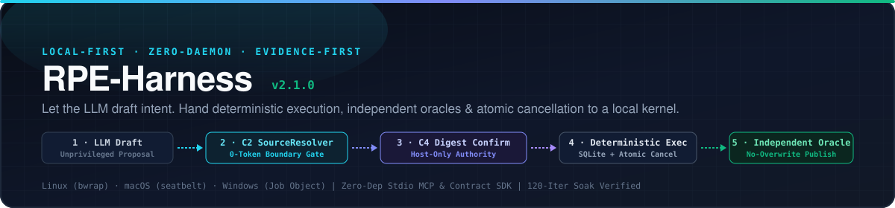

<div align="center">



<br />

[](https://github.com/Audrey-cn/rpe-harness/actions/workflows/ci.yml)

`v1.19.0` · `Linux / macOS / Windows` · `Python 3.10+ & Node.js 20+` · `零常驻服务` · `SQLite + 1 个依赖` · `MIT 许可证`

<p><a href="README.md"><strong>English</strong></a> | <strong>简体中文</strong></p>

<p>
  <a href="#-为什么做-rpe-harness">为什么做 RPE</a> ·
  <a href="#-核心架构">核心架构</a> ·
  <a href="#-竞品对比">竞品对比</a> ·
  <a href="#-四大家族真实对照实测">四大家族实测</a> ·
  <a href="#-30-秒快速上手">快速上手</a> ·
  <a href="#-诚实的当前边界">当前边界</a>
</p>

</div>

---

## 🎯 为什么做 RPE-Harness

市面上大多数 Agent 框架都在教大模型“更自由地调用工具”，但在真实本地工作流里，这会带来四个高频翻车点：

1. **模型自证陷阱**：模型口头汇报“已处理完成”，却悄悄把前导零 `0041` 吃成 `41`、把 JSON 里的 `1.0` / `-0` 改写掉，或者直接覆盖损坏了源文件。
2. **审批伪造与陈旧执行**：普通“允许调用工具”不等于确认具体参数；UI 切了任务或源文件变了，旧确认仍可能被误执行。
3. **取消与发布的竞态谎言**：用户点击停止时任务刚好写盘，普通框架要么静默覆盖，要么在文件已发布后假装回滚成功。
4. **在不可解请求上白烧 token**：重型 Agent 跑完几万 token 才发现缺关键业务键或两份文档互相冲突。

**RPE-Harness 反过来划分权限边界：**

> **让大模型只负责起草意图；把授权来源补取、digest 绑定用户确认、确定性执行、独立 Oracle 验收与原子取消，全部收回零常驻服务的本地 SQLite 可信内核。**

---

## 🏗️ 核心架构

```mermaid
flowchart LR
    U["自然语言任务 + 授权来源"] --> C2["C2 SourceResolver\n(0-Token 门禁：found / needs_user / conflict / stale / forbidden)"]
    C2 -->|仅透传授权事实| LLM["任意大模型 / 宿主\n(MiMo · DeepSeek · GPT · Gemini)"]
    LLM -->|无权执行草案| C4S["C4 HostAPI.start_task\n(operation_id + generation=1)"]
    C4S --> C4C["C4 HostAPI.confirm_task\n(仅宿主可构造 TrustedHostAction + Digest 绑定)"]
    C4C --> EXEC["确定性执行器\n(原子取消围栏 · 禁止覆盖输出)"]
    EXEC --> ORACLE["独立产物 Oracle\n(Hash + 词法 + 行序不变量复算)"]
    ORACLE -->|验真通过| PUB["独占原子发布 + SQLite 审计回执"]
```



### 核心能力矩阵（`v1.19.0`）

| 模块 | 代码入口 | 核心保证 |
| :--- | :--- | :--- |
| **C2 · 窄授权来源补取** | [`source_resolver.py`](src/rpe_harness/source_resolver.py) | 仅在显式授权的 `source_refs` 内最多做 2 次有界读取；**~1 ms、0 token** 确定性拦截 `needs_user / conflict / stale / forbidden`，彻底隔离来源里的无关隐私字段。 |
| **C4 · 宿主无关任务门面** | [`host_api.py`](src/rpe_harness/host_api.py) · [`operations.py`](src/rpe_harness/operations.py) · [`host_cli.py`](src/rpe_harness/host_cli.py) | 7 个标准方法（`start / show / confirm / execute / cancel / reconcile / handoff`）+ 薄 JSON CLI（`rpe host ...`）；不导入任何 Agent 循环，复用同一 SQLite 账本。 |
| **C4 · 原子取消 vs 发布竞态** | [`storage.py`](src/rpe_harness/storage.py) · [`server.py`](src/rpe_harness/server.py) · [`file_lock.py`](src/rpe_harness/file_lock.py) | 幂等 CLI（`runs cancel`）与回环 HTTP（`POST /runs/<id>/cancel`）；立即围栏发布，已进入发布则如实返回 `too_late`；内置 `fcntl`（POSIX）+ `msvcrt`（Windows）跨平台文件锁。 |
| **A2 · DSH 第二宿主薄适配** | [`integrations/dsh/`](integrations/dsh/) | 零依赖 Node.js ESM 插件（`execFile` 对接 `rpe host`）；注入不可伪造的 `host_id: "dsh"`/`owner`/`session_id`；`confirm/execute/cancel/handoff` 严禁暴露给模型；跨宿主交接强制废止原确认（**G2 门禁**）。 |
| **签名能力资产与回滚** | [`assets/`](src/rpe_harness/assets/) · [`evolution/`](src/rpe_harness/evolution/) | 吸收原 Progenitor 协议的 SHA-256 内容寻址与 RSA-SHA256 双签名来源校验，彻底去除 P2P/IPFS 守护进程；导入候选默认 `unverified`，须经独立验收才可 CAS 激活或一键回滚。 |
| **OS 级进程沙箱后端** | [`evolution/sandbox.py`](src/rpe_harness/evolution/sandbox.py) | 支持 macOS `/usr/bin/sandbox-exec` 与 Linux `bwrap`（bubblewrap）及内存/超时监控；不支持平台严格 fail-closed 返回 `unavailable`，绝不伪造隔离。 |

---

## ⚖️ 竞品对比

| 维度 | **LangGraph** | **Temporal / Trigger.dev** | **PydanticAI / TrueForge** | **RPE-Harness（本项目）** |
| :--- | :--- | :--- | :--- | :--- |
| **核心定位** | 通用多 Agent 状态图编排 | 云原生持久化分布式工作流 | 类型安全 Agent 运行时 | **本地优先、可验证执行与审批内核** |
| **运行依赖** | 重框架生态 + Checkpointer | 需 Temporal 集群 / 云服务 | SDK + 外部沙箱/可观测平台 | **零常驻服务 · 单 SQLite · 仅 1 个依赖（`openpyxl`）** |
| **HITL 审批粒度** | 节点级 `interrupt()` | Workflow 级 Waitpoint | 工具级审批 | **宿主独占 `TrustedHostAction` + `proposal digest` + 跨宿主自动失效** |
| **结果验收方式** | 用户自写校验节点 | 业务代码 | Schema + LLM-as-a-judge | **强制独立确定性 Oracle 复算 + 独占原子无覆盖发布** |
| **跨平台验证** | Python / JS | 云端 / Docker | Python / TS | **Linux · macOS · Windows 三平台 CI（Python + Node.js DSH）** |

---

## 📊 四大家族真实对照实测

2026-11-27 在 **4 个模型家族**上运行完全相同的 4 项受控任务（2 项正向确定性执行 + 2 项负例边界探针），原始回执见 [`reports/v1.18.0/c3-multimodel-comparison/`](reports/v1.18.0/c3-multimodel-comparison/README.md)：

| 模型 | 接入形态 | RPE 通过率 | 原生通过率 | RPE 总开销 | 原生总开销 | 降幅 |
| :--- | :--- | :---: | :---: | ---: | ---: | ---: |
| **`mimo-v2.6-pro`**（Xiaomi） | 原始 API | **4/4** | 4/4 | **309 tok** | 869 tok | **−64.4%** |
| **`deepseek-chat`**（DeepSeek） | 原始 API | **4/4** | 4/4 | **219 tok** | 541 tok | **−59.5%** |
| **`gpt-6.1-sol`**（OpenAI） | `codex-cli` Agent 外壳 | **4/4** | 4/4 | **28,156 tok** | 88,086 tok | **−68.0%** |
| **`Gemini`**（Google） | Antigravity 子代理 | **4/4** | 4/4 | **159 chars** *(仅 2 次调用)* | 203 chars *(4 次调用)* | **−21.7% 字符** *(底层 token 未暴露)* |

> **诚实口径说明**：本轮为每模型 4 项受控小文件任务（6 行 CSV / 7 行 JSON），不直接外推多小时无人值守长跑；`codex-cli` 计数包含完整 CLI 系统/工具提示词开销（仅在同一外壳内纵向可比）；Gemini 子代理未暴露底层 token，故诚实报告输出字符数与调用次数。另在 `v1.15.3` 真实 Hermes XLSX 实测（[`报告`](reports/v1.15.3/1.15.3兼容与复验.md)）中，RPE 与原生输出逐字节相同，总 token 减少 **−82.8%**（`11,755` vs `68,327`）。

---

## 🚀 30 秒快速上手

### 1. 安装（Linux / macOS / Windows 通用）

```bash
git clone https://github.com/Audrey-cn/rpe-harness.git
cd rpe-harness
python -m venv .venv
# macOS/Linux: source .venv/bin/activate  |  Windows: .venv\Scripts\activate
pip install -e ".[dev]"
rpe-harness host capabilities
```

### 2. 从 Python 接入（`HostAPI`）

```python
from rpe_harness.host_api import HostAPI, TrustedHostAction

api = HostAPI("/path/to/runs.sqlite")

# 1. 模型只起草无权执行的草案（绝不自动确认）
op = api.start_task(request_payload, {
    "host_id": "my-app", "owner": "alice",
    "session_id": "sess-1", "workspace": "/path/to/workspace",
})

# 2. 只有可信宿主的用户确认回调才可构造 TrustedHostAction
receipt = api.confirm_task(
    op["operation_id"], op["digest"],
    TrustedHostAction(owner="alice", operation_id=op["operation_id"],
                      generation=op["generation"], digest=op["digest"], actor="alice"),
)

# 3. 确定性执行 + 独立 Oracle 验真落盘
result = api.execute_task(op["operation_id"], "alice", confirmation_id=receipt["confirmation_id"])
```

### 3. 从 Node.js / DSH 接入（`integrations/dsh/`）

```js
import { createDshRpePlugin } from './integrations/dsh/index.mjs';

const { modelTools, trustedActions } = createDshRpePlugin({
  dbPath: '/path/to/runs.sqlite',
  repoRoot: '/path/to/rpe-harness',
});

// 仅把 `modelTools` 暴露给大模型；`trustedActions` 严格留在宿主侧
const op = await modelTools.rpe_start_task(modelDraft, {
  owner: 'alice', sessionId: 'dsh-1', workspace: '/path/to/workspace',
});
const conf = await trustedActions.confirmTask({
  operationId: op.operation_id, digest: op.digest,
  generation: op.generation, owner: 'alice', userApproved: true,
});
const res = await trustedActions.executeTask({
  operationId: op.operation_id, owner: 'alice', confirmationId: conf.confirmation_id,
});
```

---

## ⚠️ 诚实的当前边界

我们把边界和基准数据写得一样透明：

1. **内置业务契约面较窄**：当前内置 **3 个带独立 Oracle 的核心契约**（CSV/XLSX 去重、`json.normalize/v1`、受控 XLSX 读取），定位为高可信执行内核参考实现与协议底座，而非百宝箱式通用助手。
2. **OS 级强沙箱范围**：外部候选代码的文件系统/网络强隔离支持 macOS `/usr/bin/sandbox-exec` 与 Linux `bwrap`；在 Windows 或未装 `bwrap` 的主机上，`sandbox_backend()` 会如实返回 `unavailable` 并严格 fail-closed。
3. **桌面 UI 与长跑验证**：桌面宿主 UI（NewCC）与多小时无人值守日用门禁（`G3`/`G4`）仍在下游推进中，当前证据覆盖单测/集成不变量、三平台 CI 与受控多模型对照。

---

## 📚 延伸文档

| 内容 | 链接 |
| :--- | :--- |
| 英文主首页 | [README.md](README.md) |
| 阿卡夏（Progenitor）资产融合设计 | [docs/fusion.md](docs/fusion.md) |
| DSH 第二宿主薄适配说明与端到端测试 | [integrations/dsh/README.md](integrations/dsh/README.md) |
| 四大家族真实 C3 对照报告 | [reports/v1.18.0/c3-multimodel-comparison/README.md](reports/v1.18.0/c3-multimodel-comparison/README.md) |
| `v1.15.3` 真实 Hermes XLSX 实测报告 | [reports/v1.15.3/1.15.3兼容与复验.md](reports/v1.15.3/1.15.3兼容与复验.md) |
| 许可证 | [MIT](LICENSE) · [第三方声明](THIRD_PARTY_NOTICES.md) |
