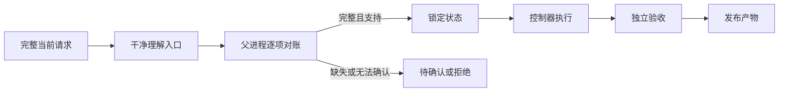

# RPE-Harness 1.9 开发与验收报告

1.9 把“这次任务到底要求什么”从聊天记忆里分离出来：理解节点只接当前完整原文和固定能力说明；父进程把明确要求逐项对账；通过后由程序按锁定参数执行。无法对账就停在待确认或拒绝状态。现有三项业务能力、执行器、独立验收和 Hermes 生命周期继续复用。

## 已落地

1. 干净理解入口：完整当前请求由父进程捕获，实际 API 消息重建；宿主旧消息、profile、工具历史不进入理解消息。发送前核验整份有效请求摘要。插件失效、消息/配置被修改、未知附加字段都会在模型发送前阻断。真实 SDK 测得普通中间件异常会继续请求，因此增加 clean 专用 bootstrap 保护。OpenAI SDK 2.24.0 的模拟 HTTP 检查接受2个正常请求、阻断19种额外通道，真实网络请求为0。
2. 可追溯要求清单：严格 JSON 的 capability、constraints 和每个 execution 字段均绑定当前原文 SHA、JSON pointer、字段值与验收字段。显式的编码、分隔符、sheet 等不能因默认值相同而漏提；未知要求不能塞进 goal。原文、清单、输入、会话或目录信任变化会拒绝。
3. 确定性执行：真实模型只调用 rpe_understand，父进程随后调度既有 broker、路径绑定、固定 worker、原子发布和独立 oracle。控制器使用独立收据，记录真实理解调用的来源，不伪造模型 rpe_task 调用。结束汇报的模型消耗另行计入。跨 broker 同时领取曾复现两次准入，已用数据库原子声明修复；独立复测为一成功、一拒绝、一个执行收据。
4. 公开零模型准备接口：source prepare/show 和 Python SourceStateStore；Hermes 显式 --entry-mode clean 执行。旧 address/skills/strict 路径继续兼容，完整性保证按入口区分。无新增运行依赖、常驻服务、分类器或学习循环。

## 可用范围

自动执行限定为完整严格 JSON 来源和已注册的 tabular.deduplicate、json.normalize、xlsx.inspect。JSON 根仅 capability/constraints/execution；不能携带 goal、note、重复键、未知字段或额外自由文字。自由文字进入 needs_context，须确认成完整结构化当前请求。清单证明这份来源的字段覆盖，无法证明用户所有自然语言意图都已表达。XLSX 检查需要已审核原生 helper 绑定。

消息、工具与状态授权隔离已验证；逻辑节点共用宿主进程，执行 worker 继续独立隔离。API 请求允许表针对当前已验证的小米兼容接口；其他宿主/接口须建立自己的适配证据。Hermes 的通用记忆、技能维护和调度继续由宿主管理。本轮隔离测试关闭记忆/自动升级以固定条件，未验证长期飞轮收益。没有自动接管日常 Hermes 聊天。

## 验证

最终代码 aa083c9af5f949a31aff9deabd7d775c6e1e6b6b（发送边界修复634768f）。完整回归：1524 passed, 3 subtests passed in 323.68s (0:05:23)，零跳过。旧状态schema和原生/task准入保持回归覆盖。

独立安装：153项检查、72个.py的源码/wheel/安装字节一致。wheel SHA256：`e640ed87f3d527a79d25367b2660bf58718879795bbb53398257142150192bab`。安装冒烟验证来源准备、清单、旧执行器和实际产物；Hermes真实接线、控制器和发送阻断由独立SDK/实际会话验证。独立审查无未解决P1/P2；见 verification/independent-review.md。

初始1510项完整回归后，模拟最终HTTP发现附加请求体通道，修复后重新运行最终全套；本轮没有训练、重复抽样、追加模型修分。较早无模型预登记作废保留摘要，真实模型调用为零；最终登记为 `bceb4a088223aaa61892914e1df81c7cb25f03f1e0659f11eef6e328e37bcf8d`。

## 原生对照

一次接线测试每臂1会话；正式固定6对任务：CSV复合关键列、真实TAB、无损JSON、原生XLSX helper，以及缺关键列、自由文字额外要求两个来源边界检查。双方同原文、文件、模型配置、Python依赖、技能快照与公开契约说明；标准答案仅由控制器验收。原生保留工具搜索，clean 使用固定理解入口与控制器，因此只比较整体策略。

|正式策略|生产业务正确|生产完整验收链|来源边界终态|总token|可见API请求|完整任务耗时合计|
|---|---:|---:|---:|---:|---:|---:|
|Hermes 原生|4/4|2/4|0/2|246610|30|219.63s|
|RPE clean|4/4|4/4|2/2|17156|12|148.83s|

生产与边界检查分别评分，待确认不算生产完成。原生业务正确但未通过完整链的记录：2。错误码分别为[["native_output_invocation_missing"], ["native_original_helper_execution_missing"]]；这是证据核验不足，不能解读为这些产物业务错误。

实际会话模型身份：{"provider": "xiaomi", "requested_model": "mimo-v2.6-pro", "response_models": ["mimo-v2.6-pro"]}；所有记录模型一致=True。clean 来源追溯核验6/6，其中生产要求清单4/4，拒绝来源追溯2/2；控制器生产执行核验4/4。配对可比性成立：True。正式任务总token相对原生变化：减少93.04%，限此固定任务组。1.8使用自然语言源，本轮使用严格来源协议，两次实验不能直接计算版本提升率。

全部接线测试与正式会话合计 14 次，失败阶段 4，未完成阶段 0：305551 token，49个可见逻辑API请求；usage覆盖完整=True，缺测=0。实际账单、cache写入和RSS未测得，不填零或换算金额。正式原生cache读token为213376，clean为3840；未缓存输入token分别25340和7947，输出分别7894和5369，因此93%的总token差额不能直接当作费用节省比例。

完整任务耗时从控制器观察入口算到启动、模型、执行、验收与来源复核结束；原会话计时保存在 session_elapsed_seconds。全任务耗时合计 426.11s；驱动动作耗时：pilot 59.57s，formal 377.32s，另含冻结检查、账本/汇总。开发代理、单元测试、构建和公共预登记不混入运行策略成本；目标模式开发用量另记快照。

边界探针中，原生缺key_columns仍产生output.csv，违反本次必须待确认的协议；clean没有执行并返回缺少字段。自由文字探针中原生写出正确terminal.json，发布链未被识别；clean通过持久拒绝收据。四个未通过完整链的阶段均原样入账。

该结果只支持已登记的严格来源和三个能力，不推导任意自由文字、更多宿主、长期无人值守或通用学习优势。每条失败和成本保留在 public-evidence/summary.json、cost-phases.json；运行身份链是当时核验记录，离线验证可复算公开来源/清单/业务产物，不提供第三方身份签名。

## 交付与清理

本地1.9源码、wheel、todo、公开证据保留；使用方式见 ../../docs/clean-source.md。清理结果以 cleanup.json 为准：只删除本轮owned-root中的测试历史、隔离家目录、凭据副本、缓存、虚拟环境和临时数据；核对会话/进程归属，保留日常运行状态、旧仓与原讨论报告。工作树通过原生归档保存可恢复快照，不推送远端。

清理已实测完成：本轮owned-root已移除，48929个文件、约831MB；14会话均完成精确进程清理，残留进程0，日常Hermes中本轮session ID数为0。删除原始测试DB/历史后，公开证据再次复验成功：6来源、10正确业务产物、7条clean来源追溯。日常文件变化只记录摘要并保留当前状态；原讨论报告和两个旧仓均保持初始内容/状态。工作树原生归档已确认，物理目录已移除，详情见cleanup.json。

主项目已交付到codex/rpe-v1.9-release；实际CLI版本1.9.0，主项目72源码文件与验收wheel一致，Git提交保留公开证据原始字节。旧1.8分支及安装包保留，本轮未推送远端。
